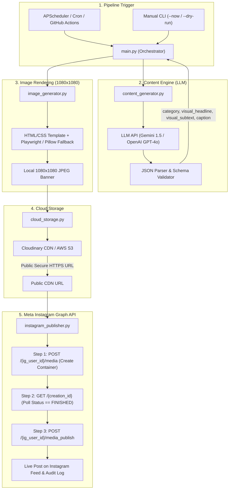

# 🖨️ AI Social Media Agent - Percetakan & Packaging (Instagram Automation)

Sistem backend otonom end-to-end untuk memproduksi konten edukasi berkualitas tinggi seputar industri percetakan (*digital printing, offset, packaging, paper material, dan finishing*) dan mempublikasikannya secara otomatis & terjadwal ke Instagram Feed menggunakan **Meta Graph API resmi**.

---

## 🏛️ Arsitektur Sistem



---

## 📂 Struktur Direktori Proyek

```text
d:\ai agent\
├── .env.example              # Template variabel lingkungan (API keys & tokens)
├── requirements.txt          # Dependensi Python
├── config.py                 # Manajemen konfigurasi terpusat & validasi
├── content_generator.py      # Content engine LLM & JSON parser 4 pilar
├── image_generator.py        # Render banner 1080x1080 (Playwright & Pillow fallback)
├── cloud_storage.py          # Uploader ke Cloudinary / AWS S3 (public secure URL)
├── instagram_publisher.py    # Integrasi Meta Graph API (2-step container publishing)
├── main.py                   # Orkestrator utama & scheduler harian
├── templates/
│   └── banner.html           # Template visual HTML/CSS dengan aksen CMYK & crop marks
├── storage/
│   ├── output/               # Arsip gambar lokal hasil generate
│   ├── publish_history.json  # Riwayat publikasi dan audit trail
│   └── agent.log             # File log sistem
└── README.md                 # Dokumentasi teknis & setup guide
```

---

## ⚙️ 4 Pilar Konten Percetakan

1. **Edukasi Teknis**: Perbedaan CMYK vs RGB, resolusi 300 DPI, bleed dan safe zone 3mm, format file standar cetak (PDF/X-1a, TIFF, Vector EPS), trapping & overprint.
2. **Material & Kertas**: Karakteristik Art Paper vs Art Carton, keunggulan Ivory untuk kemasan, Kraft Coklat & Corrugated Eco-friendly, panduan gramatur (GSM), dan arah serat kertas (*grain direction*).
3. **Finishing Pasca Cetak**: Laminasi Doff vs Glossy, efek Spot UV, Hot Stamping Foil emas/silver, Emboss/Deboss 3D, teknik Pond/Die-cut pola kemasan, jilid kawat vs lem panas (*perfect binding*).
4. **Tips Bisnis & Efisiensi**: Trik hemat layout cetak massal (*gang run printing*), tips kemasan premium budget UMKM, mencegah hasil cetak belang/banding, dan checklist *pre-flight*.

---

## 🚀 Panduan Instalasi & Persiapan

### 1. Clone & Setup Virtual Environment
```bash
# Masuk ke direktori proyek
cd "d:\ai agent"

# Buat virtual environment (opsional namun disarankan)
python -m venv venv
venv\Scripts\activate

# Install dependensi
pip install -r requirements.txt

# (Opsional) Install browser Playwright untuk rendering HTML/CSS pixel-perfect:
playwright install chromium
```
> **Catatan**: Jika Playwright belum diinstal, sistem secara otomatis beralih ke engine visual bawaan **Pillow** tanpa error!

### 2. Konfigurasi `.env`
Salin `.env.example` menjadi `.env` dan lengkapi kredensial:
```bash
copy .env.example .env
```

---

## 🔑 Panduan Ringkas Setup Token Meta Graph API

Instagram Graph API mewajibkan **Akun Profesional (Bisnis atau Kreator)** yang terhubung ke sebuah **Facebook Page**.

### Langkah 1: Hubungkan Instagram ke Facebook Page
1. Buka profil Instagram Anda > **Pengaturan** > **Jenis dan Alat Akun** > Beralih ke **Akun Profesional** (*Bisnis* atau *Kreator*).
2. Hubungkan akun Instagram tersebut ke salah satu **Facebook Page** yang Anda kelola.

### Langkah 2: Buat Meta Developer App
1. Masuk ke [Meta for Developers](https://developers.facebook.com/).
2. Klik **My Apps** > **Create App**.
3. Pilih tipe aplikasi **Other** > Next > Pilih **Business**.
4. Beri nama aplikasi (contoh: `Print Social Automation`).

### Langkah 3: Berikan Izin Akses (Permissions)
Buka menu **App Dashboard** > **Tools** > **Graph API Explorer**:
Tambahkan permissions berikut pada token:
- `instagram_basic`
- `instagram_content_publish`
- `pages_show_list`
- `pages_read_engagement`
- `pages_manage_posts`

### Langkah 4: Dapatkan `INSTAGRAM_ACCOUNT_ID`
Jalankan query berikut di Graph API Explorer:
```http
GET me/accounts?fields=name,instagram_business_account
```
Respon JSON akan memberikan:
```json
{
  "data": [
    {
      "name": "Percetakan Anda",
      "instagram_business_account": {
        "id": "17841400012345678"
      }
    }
  ]
}
```
Salin nilai ID tersebut ke `INSTAGRAM_ACCOUNT_ID` pada `.env`.

### Langkah 5: Dapatkan Token Akses Jangka Panjang (Long-Lived Token)
Token dari Graph API Explorer hanya bertahan 1 jam. Untuk mengubahnya menjadi **Token 60 Hari**:
Jalankan request HTTP:
```http
GET https://graph.facebook.com/v19.0/oauth/access_token?
  grant_type=fb_exchange_token&
  client_id={META_APP_ID}&
  client_secret={META_APP_SECRET}&
  fb_exchange_token={SHORT_LIVED_TOKEN}
```
Hasilnya adalah `access_token` berumur 60 hari.

### Langkah 6 (Rekomendasi Produksi): Token Permanen via System User
Jika Anda tidak ingin me-refresh token tiap 60 hari:
1. Buka [Meta Business Suite](https://business.facebook.com/settings).
2. Masuk ke **Users** > **System Users** > Klik **Add**.
3. Beri nama `Agent-Bot` dengan role `Admin`.
4. Klik **Add Assets** > Berikan akses ke Facebook Page dan Instagram Account terkait.
5. Klik **Generate New Token** > Pilih App Anda > Centang izin `instagram_content_publish`, `instagram_basic`, dll.
6. Token ini **tidak akan pernah kadaluarsa** (*Never Expiring Token*).

---

## ☁️ Panduan Cloud Storage (Cloudinary / S3)

Instagram API memerlukan direct URL publik (bukan base64 atau localhost):
1. **Cloudinary (Gratis & Sangat Cepat)**:
   - Daftar di [Cloudinary.com](https://cloudinary.com).
   - Salin `Cloud Name`, `API Key`, dan `API Secret` dari Dashboard ke `.env`.
2. **AWS S3**:
   - Jika memilih AWS, buat bucket S3 dengan akses pembacaan objek publik atau bucket policy yang mengizinkan Meta bot mengunduh gambar.

---

## 🎮 Penggunaan Sistem (CLI & Scheduler)

### 1. Uji Coba Tanpa Publish (Dry Run)
Menghasilkan konten AI dan merender gambar banner 1080x1080 secara lokal tanpa upload atau mempublikasikan ke Instagram:
```bash
python main.py --dry-run
```

### 2. Eksekusi Sekali Langsung (Publish Now)
Menjalankan seluruh siklus (Generate -> Render -> Upload Cloud -> Publish Instagram):
```bash
python main.py --now
```

### 3. Eksekusi Berdasarkan Kategori Spesifik
```bash
python main.py --now --category "Material & Kertas"
```

### 4. Menjalankan Scheduler Daemon Terus-menerus (APScheduler)
Aplikasi akan terus berjalan di latar belakang dan memicu postingan setiap hari pada jam yang dikonfigurasi di `.env` (`SCHEDULE_HOUR=09:00`):
```bash
python main.py --schedule
```

---

## ⏰ Alternatif Penjadwalan Produksi

### Opsi A: Linux Crontab (VPS / Server)
Jika dijalankan di VPS Ubuntu/Debian:
```bash
# Buka crontab
crontab -e

# Eksekusi setiap hari jam 09:00 WIB (02:00 UTC)
0 2 * * * cd /path/to/ai-agent && /path/to/venv/bin/python main.py --now >> /var/log/ig_agent.log 2>&1
```

### Opsi B: GitHub Actions (Serverless Tanpa Biaya Server)
Buat file `.github/workflows/daily_publisher.yml`:
```yaml
name: Daily Print Instagram Publisher

on:
  schedule:
    # Jam 02:00 UTC = Jam 09:00 WIB
    - cron: '0 2 * * *'
  workflow_dispatch: # Memungkinkan eksekusi manual dari UI GitHub

jobs:
  publish:
    runs-on: ubuntu-latest
    steps:
      - uses: actions/checkout@v4
      - name: Set up Python
        uses: actions/setup-python@v5
        with:
          python-version: '3.11'
      - name: Install Dependencies
        run: |
          pip install -r requirements.txt
      - name: Execute Publisher
        env:
          LLM_PROVIDER: ${{ secrets.LLM_PROVIDER }}
          GEMINI_API_KEY: ${{ secrets.GEMINI_API_KEY }}
          STORAGE_PROVIDER: ${{ secrets.STORAGE_PROVIDER }}
          CLOUDINARY_CLOUD_NAME: ${{ secrets.CLOUDINARY_CLOUD_NAME }}
          CLOUDINARY_API_KEY: ${{ secrets.CLOUDINARY_API_KEY }}
          CLOUDINARY_API_SECRET: ${{ secrets.CLOUDINARY_API_SECRET }}
          INSTAGRAM_ACCOUNT_ID: ${{ secrets.INSTAGRAM_ACCOUNT_ID }}
          INSTAGRAM_ACCESS_TOKEN: ${{ secrets.INSTAGRAM_ACCESS_TOKEN }}
        run: |
          python main.py --now
```

---

## 🛡️ Audit & Logging
- Seluruh riwayat publikasi (kategori, headline, URL gambar, media ID Instagram, permalink, durasi) disimpan otomatis di `storage/publish_history.json`.
- Log operasional detail disimpan di `storage/agent.log`.
